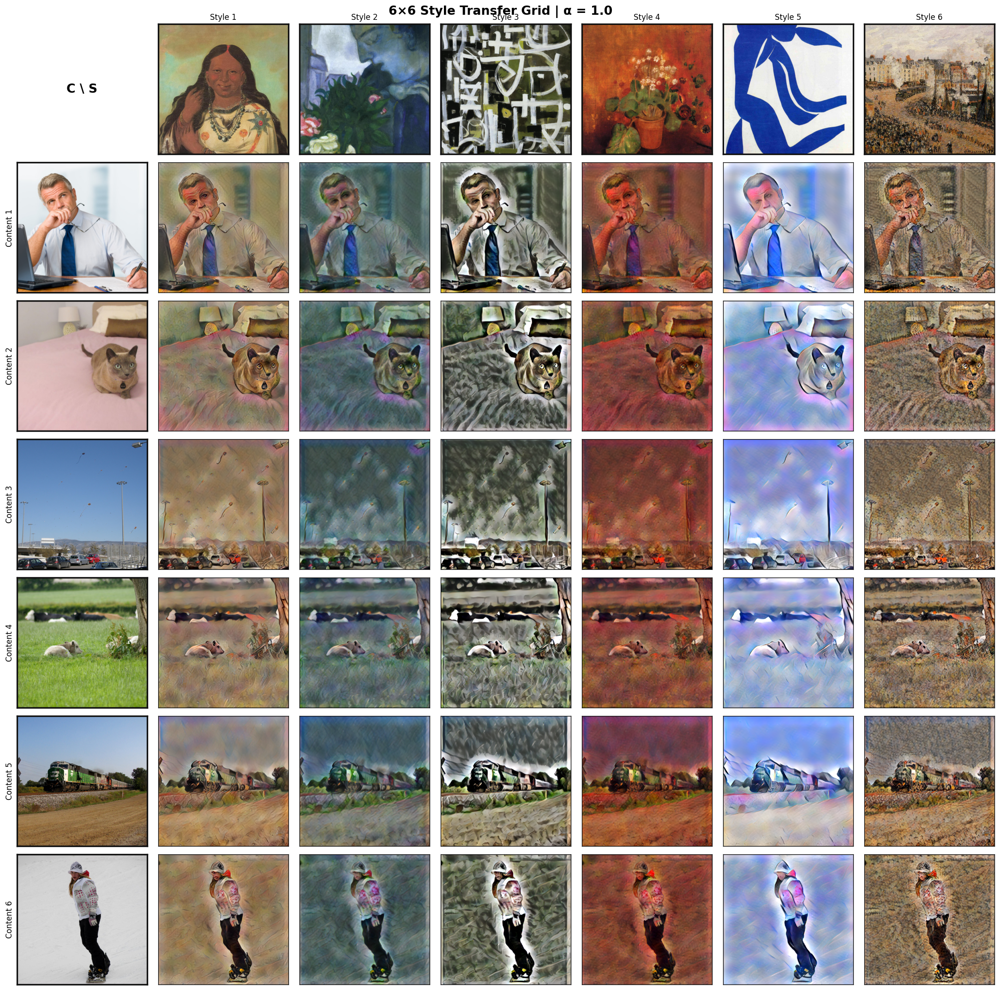
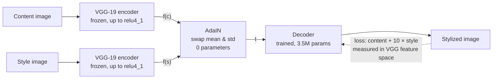
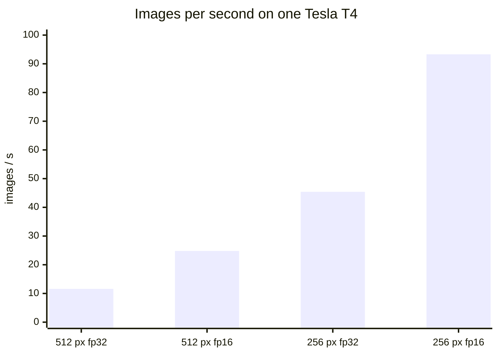
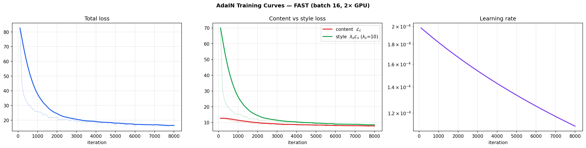
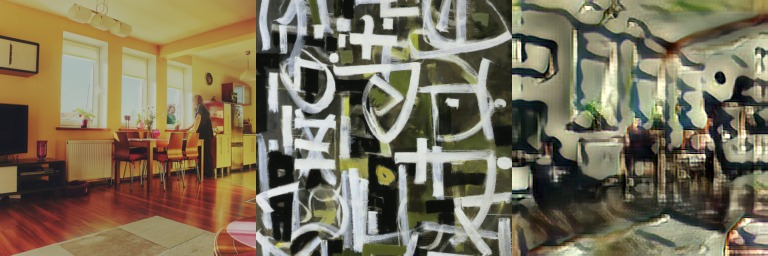
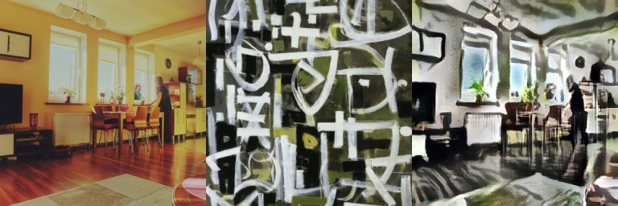
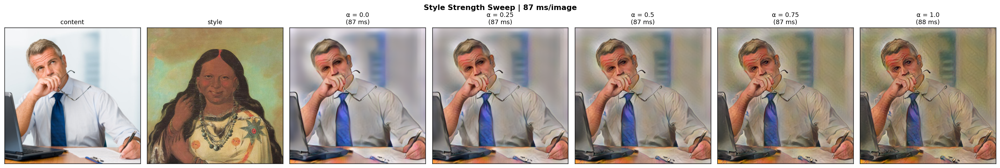
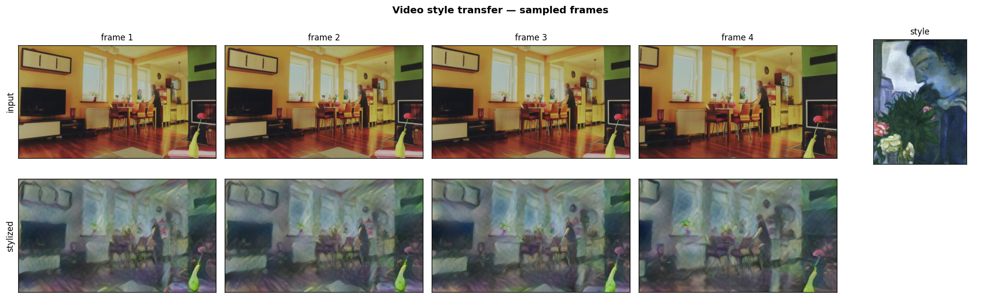

# AdaIN: Real-Time Arbitrary Style Transfer

**Render any photo in the style of any painting, in one forward pass, including paintings the model never saw in training.**

A PyTorch reimplementation of Adaptive Instance Normalization (Huang & Belongie, ICCV 2017). The decoder was trained from scratch on MS-COCO and WikiArt in **under an hour on one Tesla T4**, and stylizes a 512×512 image in **40 ms**.


*Rows: COCO photos. Columns: WikiArt paintings held out from training. One decoder produces all 36 images.*

## Highlights

- **One network, every style.** Classic style transfer optimizes each image over hundreds of iterations; fast methods need one network per style. AdaIN does any style in real time.
- **Trained from scratch** on 20k COCO photos and 10k WikiArt paintings with fp16 mixed precision: 8,000 iterations in 0.91 h.
- **Real time:** 93 images/s at 256 px and 25 images/s at 512 px in fp16; 11.5 FPS on video.
- **Built to survive Kaggle sessions:** exact mid-run resumption, checkpoints synced to the Hugging Face Hub, and a clean stop before the 12-hour limit.

**Stack:** Python · PyTorch · torchvision · Hugging Face Hub · OpenCV · Kaggle (T4 GPU)

## Architecture



The style of an image is largely captured by the **mean and standard deviation** of each channel of its deep features. AdaIN gives the content features the style's statistics:

$$\text{AdaIN}(x, y) = \sigma(y)\left(\frac{x - \mu(x)}{\sigma(x)}\right) + \mu(y)$$

The layer has no learnable weights, so a new style only means new statistics, never retraining. Only the decoder is trained, to turn re-styled features back into an image. Style strength is set at inference by blending: $t_\alpha = \alpha\,\text{AdaIN}(x, y) + (1-\alpha)\,x$.

<details>
<summary>Loss functions</summary>

With $g$ the decoder, $f$ the encoder, $\phi_i$ encoder layer $i$, $t$ the AdaIN output and $s$ the style image:

$$\mathcal{L}_c = \lVert f(g(t)) - t \rVert_2^2$$

$$\mathcal{L}_s = \sum_{i=1}^{4} \lVert \mu(\phi_i(g(t))) - \mu(\phi_i(s)) \rVert_2 + \lVert \sigma(\phi_i(g(t))) - \sigma(\phi_i(s)) \rVert_2$$

$$\mathcal{L} = \mathcal{L}_c + 10\,\mathcal{L}_s$$

The content target is the AdaIN output $t$, not the photo's own features, so the decoder learns to decode *re-styled* features faithfully.

</details>

## Results

### Speed



fp16 halves latency, and 256 px is about 4× faster than 512 px (4× fewer pixels). Full pipeline: encode both images, AdaIN, decode.

### Training



| Loss | Start | End |
|---|---|---|
| Total | 49.28 | **16.37** |
| Content | 12.58 | **7.85** |
| Style | 3.67 | **0.85** (÷4.3) |

The style loss falls fastest: matching statistics is the easy part. Rebuilding a sharp image is harder, so the content loss falls more slowly. Both are still decreasing at 8,000 iterations, so a longer run would keep improving.

| Iteration 1,000 | Iteration 8,000 |
|---|---|
|  |  |

### Style strength (α)



The style blends in smoothly from α = 0 (the decoder's reconstruction of the photo) to α = 1 (full style).

### Video



Frames are stylized one by one with the style statistics computed once: **11.5 FPS** at 256 px. Clips: [input](video/demo_input.mp4) → [stylized](video/demo_input_stylized_h264.mp4).

### What works and what doesn't

- Each painting's palette and texture transfer while the photo stays recognizable; high-contrast, textured styles transfer best.
- AdaIN transfers **statistics, not shapes**: a Matisse cut-out passes on its colors but not its large flat forms.
- Large uniform regions (sky, snow) take the most texture; faces are softened.

## Training setup

| Setting | Value |
|---|---|
| Data | 20,000 COCO 2017 photos, 10,000 WikiArt paintings (+100 held out for evaluation) |
| Pre-processing | Shorter side resized to 512, random 256×256 crop |
| Optimizer | Adam on the decoder only, learning rate decayed from 2e-4 to 1.1e-4 |
| Batch / precision | 16, fp16 autocast with gradient scaling |
| Run | 8,000 iterations, 0.41 s each, on 1× Tesla T4 (Kaggle) |

<details>
<summary>Engineering details</summary>

- **Exact resumption.** A fixed-seed sequence of `iterations × batch_size` sample indices is generated up front, so resuming at iteration *k* is a slice of it and a new session continues on exactly the right samples.
- **Persistent checkpoints.** Decoder, optimizer, AMP scaler and loss history are saved atomically every 1,000 iterations and uploaded to a private Hugging Face repo; a new session restores the newest automatically.
- **Fast loading.** PIL's `draft` mode downsamples large WikiArt JPEGs during decoding; file lists are cached.
- **Robustness.** A one-step GPU check and a data check before training, RAM/GPU memory logs, `faulthandler` stack dumps, and a checkpoint-and-stop before Kaggle's 12-hour limit.

</details>

## Run it

**On Kaggle:** GPU T4, Internet on, and add a COCO 2017 dataset (with `train2017/`) and a WikiArt dataset as inputs; both are detected automatically. Optionally add an `HF_TOKEN` secret so checkpoints survive between sessions. Then **Save Version → Save & Run All**.

**Locally:** `pip install -r requirements.txt`, then set `CONTENT_DIR` and `STYLE_DIR` in section 3 of the notebook.

**With the trained weights** (after running sections 1 and 5 of the notebook):

```python
decoder.load_state_dict(torch.load("weights/decoder_final.pth", map_location=DEVICE))
decoder.eval()
out = stylize(load_image("photo.jpg", size=512), load_image("painting.jpg", size=512), alpha=0.8)
TF.to_pil_image(out).save("stylized.jpg")
```

## Repository

| Path | Contents |
|---|---|
| [`AdaIN_Style_Transfer.ipynb`](AdaIN_Style_Transfer.ipynb) | Full notebook with outputs: data, model, training, results, benchmark, video |
| `weights/` | Trained decoder (14 MB) and the run's loss history |
| `figures/` | Grid, α sweep, training curves, video frames, benchmark CSV |
| `previews/` | Content, style and output at every 1,000 iterations |
| `video/` | Demo input and stylized clips |

## Next steps

- Train longer on the full datasets to sharpen details.
- Add a temporal loss to stop texture flicker between video frames.
- Color-preserving transfer, regional styles and style mixing.

## About

Group project for the **Deep Learning** module, 2SC IASD, École Supérieure en Informatique de Sidi Bel Abbès (2025/2026), supervised by Prof. N. Dif. Team: B. Abdel-ouakil, M. Safouane Mohammed, A. Ines, B. Mohammed Amdjed.

**References:** Huang & Belongie, *Arbitrary Style Transfer in Real-time with Adaptive Instance Normalization*, ICCV 2017 · Gatys et al., CVPR 2016 · Johnson et al., ECCV 2016 · Simonyan & Zisserman, ICLR 2015.
